<picture>
  <source media="(prefers-color-scheme: dark)" srcset="assets/encabezado-oscuro.svg">
  
</picture>

De día diagnostico tarjetas electrónicas en **Plexus**. Antes, en **Foxconn**, reparaba servidores **NVIDIA GB200 y GB300**
dentro de sus racks. En la tarde estudio **Ingeniería en Desarrollo de Software** en el CETI. Y en la noche construyo cosas
en mi propio servidor, una Raspberry Pi 5 que corre más de 10 servicios: un asistente que me habla por Telegram, una app
para mi iPhone y el sistema que lleva mi dinero.

Me gusta imaginar soluciones y entender cómo funciona todo por dentro. Uso la IA como herramienta para construir más
rápido, sin dejar de aprender.

EN: Electronics technician (AI servers, PCBA diagnostics) and Software Engineering student in Guadalajara, Mexico. I build and run my own homelab.

### Proyectos que uso todos los días

| | |
|---|---|
| **[KORRA](https://github.com/Chava33165/korra-asistente)** Asistente personal en Telegram: DeepSeek con tool calling + Claude Code, Google APIs, voz y memoria. | **[finanzas-api](https://github.com/Chava33165/finanzas-api)** Mi sistema de dinero: nómina, tarjetas, meses sin intereses y atajos de Apple. FastAPI, 60+ pruebas. |
| **[homelab-app](https://github.com/Chava33165/homelab-app)** App nativa de iPhone (Flutter) para mi servidor, mis finanzas y mi búsqueda de empleo. | **[homelab-dashboard](https://github.com/Chava33165/homelab-dashboard)** Panel con métricas en vivo y control de contenedores. Go + Svelte + Docker. |
| **[Watt & Beaver](https://github.com/Chava33165/WattYBeaver-Proyecto)** IoT de bajo costo para medir agua y luz en casa, con retos para ahorrar. | **[Mi portafolio](https://paginas.wattnbeaver.site/portafolio/)** Quién soy y lo que hago, servido desde mi Raspberry Pi. |

### Con lo que trabajo

<picture>
  <source media="(prefers-color-scheme: dark)" srcset="assets/stats-oscuro.svg">
  
</picture>

### ¿Platicamos?

Abierto a oportunidades en soporte técnico, infraestructura, desarrollo o DevOps junior, y en ingeniería de pruebas
de electrónica (turno matutino).

Las stats se dibujan solas cada día con una GitHub Action propia ([`generar.py`](.github/scripts/generar.py)).
